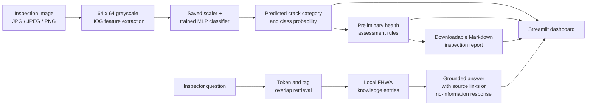

# Automated Structural Bridge Safety Inspector

A prototype dashboard for classifying concrete crack imagery, displaying a
preliminary category-based assessment, and looking up supporting bridge
inspection and preservation references. The application is intended for
demonstration and research—not for determining bridge safety.

> **Important:** This prototype is not a certified engineering safety
> assessment. Its image classifier detects only the three concrete-image
> classes listed below; it does not detect corrosion. Predictions and
> maintenance prompts must be reviewed by a qualified bridge inspector.

## Problem statement

Reviewing inspection imagery and consulting reference material are parts of
bridge inspection workflows. This project demonstrates how image
classification, a transparent preliminary ruleset, and source-linked
knowledge retrieval can be combined in one interface. It does not replace
field inspection, professional engineering judgment, or owner-adopted
procedures.

## Objectives

- Classify an uploaded concrete image as `Without Crack`, `Simple Cracks`, or
  `Multibranched Crack` using the existing trained model.
- Show the model's predicted class probability and a preliminary health
  assessment, including a manual-inspection prompt for low-confidence output.
- Retrieve relevant, cited information from the local FHWA reference knowledge
  base and clearly state when no answer is available.
- Download a timestamped Markdown report of an individual image inspection.
- Keep the dashboard and core components runnable locally and in GitHub
  Codespaces without an external AI service.

## Architecture



The image-inspection and RAG paths are separate: the RAG assistant does not
alter the model prediction or the preliminary assessment.

## Dataset

The working dataset is arranged under `data/CICS/` with 4,000 JPEG images in
each of the three class directories (12,000 files total). It is from **Cracks
In Concrete Structures (CICS) Dataset**, by Hamed Jabbari, Nooshin Bigdeli, and
Mahdi Shojaei, published by Mendeley Data on 16 June 2023 (version 1,
[DOI: 10.17632/9brnm3c39k.1](https://doi.org/10.17632/9brnm3c39k.1)). The
record describes 12,000 grayscale 330 x 330 image patches derived from
concrete structure imagery and visually classified into the three categories.
The metadata lists a [CC BY 4.0 license](https://creativecommons.org/licenses/by/4.0/);
retain attribution and confirm the provider's current terms before
redistribution. The repository's
`src/bridge_safety_inspector/CICS Dataset.zip` is a local copy of the image
archive, not required to run the dashboard.

`create_splits()` hashes images to keep exact duplicates together, removes
identical images carrying conflicting labels, and creates deterministic
70/15/15 train, validation, and test splits using seed 42. The recorded
training run used 4,064 training, 870 validation, and 874 test samples; 20
conflicting-label image files were excluded. The dataset contains crack
classes only and does not provide corrosion labels.

The data and archive are excluded from Git by `.gitignore`; obtain them from
the authorized project/dataset source and place them in the expected
directories if they are not supplied with your submission.

## Model and training approach

The existing model is a CPU-trained scikit-learn multilayer perceptron (MLP)
with one 64-unit hidden layer. Images are converted to grayscale and resized
to 64 x 64 pixels. An 8-orientation Histogram of Oriented Gradients (HOG)
descriptor (8 x 8 pixel cells, 2 x 2 cell blocks, L2-Hys normalization) is
computed and standardized before classification. Training uses Adam,
balanced mini-batches, and validation macro-F1 early stopping (maximum 12
epochs, patience 3). The saved run completed 6 epochs and restored its best
validation checkpoint from epoch 3.

The dashboard loads `models/cics_hog_mlp.joblib`; it does not retrain the
model. The accompanying
[`models/cics_hog_mlp.metrics.json`](models/cics_hog_mlp.metrics.json)
contains the recorded split, validation, and test metrics. Model files are
ignored by Git to avoid committing binary artifacts accidentally. For the
CDAC demonstration, the model is distributed separately as the
`cics_hog_mlp.joblib` asset on the GitHub Release tagged `v1.0.0`.

### Obtain the trained model

> **Release availability:** The `v1.0.0` GitHub Release must be published and
> its `cics_hog_mlp.joblib` asset uploaded before these download instructions
> will work.

1. Download `cics_hog_mlp.joblib` from the repository's
   [GitHub Releases page](https://github.com/ghassaad-cmd/Structural-Bridge-Safety-Inspector/releases),
   under release `v1.0.0`.
2. From the repository root, create the expected model directory if it does
   not already exist:

   ```bash
   mkdir -p models
   ```

3. Place the downloaded file at exactly
   `models/cics_hog_mlp.joblib`. The dashboard looks for the model at this
   path and does not download it automatically.

Alternatively, after `v1.0.0` is published with the asset, use GitHub CLI from
the repository root:

```bash
mkdir -p models
gh release download v1.0.0 \
  --repo ghassaad-cmd/Structural-Bridge-Safety-Inspector \
  --pattern cics_hog_mlp.joblib \
  --dir models
```

### Recorded evaluation

These are the values in the saved metrics artifact. Accuracy and macro-F1 are
reported on the held-out test split; per-class scores use the fixed class
order shown in the table.

| Class | Test support | Precision | Recall | F1 |
|---|---:|---:|---:|---:|
| Multibranched Crack | 82 | 69.86% | 62.20% | 65.81% |
| Simple Cracks | 390 | 84.16% | 83.08% | 83.61% |
| Without Crack | 402 | 87.98% | 91.04% | 89.49% |
| **Overall accuracy** | **874** | — | — | **84.78%** |
| **Macro average** | **874** | **80.67%** | **78.77%** | **79.64%** |

Test confusion matrix (rows are actual classes; columns are predicted classes;
order: Multibranched Crack, Simple Cracks, Without Crack):

```text
[[51, 29,  2],
 [18, 324, 48],
 [ 4, 32, 366]]
```

Performance is not uniform across classes: the recorded Multibranched Crack
recall is 62.20%. These dataset results do not establish performance in field
conditions or justify safety decisions.

## Preliminary health assessment

`assess_crack_classification()` maps the predicted category to a demonstration
severity and maintenance priority:

| Predicted category | Preliminary severity | Maintenance priority |
|---|---|---|
| Without Crack | Low (preliminary) | Routine review |
| Simple Cracks | Moderate (preliminary) | Scheduled review |
| Multibranched Crack | High (preliminary) | Prompt review |

When confidence is below the project's demonstration threshold of 0.60, the
assessment is `Uncertain`, the priority is `Manual inspection`, and the
category-based prompt is withheld. This is a simple application rule, not a
validated engineering threshold, condition rating, or bridge-safety
determination. A confidence at or above the gate does not certify the image or
bridge.

## RAG knowledge assistant

`DEFAULT_BRIDGE_KB` is a small, in-memory knowledge base. It tokenizes the
question and entry title, tags, and content, then ranks entries by shared-token
overlap. It returns answers only from entries with a named HTTP(S) source and
includes source references. If no eligible entry matches, it returns an
explicit no-information response. This is lightweight lexical retrieval and
template/extractive answering—not a generative model, exhaustive document
search, or external AI API.

The included FHWA references are:

- [Bridge Inspector's Reference Manual](https://www.fhwa.dot.gov/bridge/nbis/pubs/nhi21002.pdf)
- [Recommended Framework for a Bridge Inspection QC/QA Program](https://www.fhwa.dot.gov/bridge/nbis/nbisframework.cfm)
- [Bridge Preservation Guide](https://www.fhwa.dot.gov/bridge/preservation/guide/guide.pdf)

The knowledge base provides general references only. It contains no
project-specific maintenance records, repair designs, or certified advice.

## Streamlit dashboard

Run `app.py` from the repository root. The dashboard:

- accepts JPG, JPEG, and PNG uploads and displays the selected image;
- uses the saved model to display the predicted class and class probability;
- displays the preliminary severity, maintenance priority, explanation, and
  manual-inspection warning when required;
- answers supported reference questions with FHWA source links and indicates
  when the local knowledge base has no answer; and
- generates a downloadable Markdown inspection report with filename,
  prediction, confidence, preliminary assessment, timestamp, and limitations.

The report is an image-level prototype summary; it does not record a verified
bridge condition or prescribe repairs.

## Technologies

- Python 3.10 or later
- Streamlit
- scikit-learn, scikit-image, NumPy, Pillow, and joblib
- pytest for automated tests
- setuptools and `pyproject.toml` for packaging

Install the `training` extra for model inference dependencies and the
`dashboard` extra for Streamlit. The core dataset, health, RAG, and report
modules use the standard library.

## Installation and launch

After obtaining the model as described above, run these commands from the
repository root to install the dashboard dependencies and launch the app:

```bash
python -m venv .venv
source .venv/bin/activate
python -m pip install -e ".[training,dashboard]"
streamlit run app.py --server.address 0.0.0.0
```

On Windows PowerShell, activate with `.venv\Scripts\Activate.ps1` before
installing and launching:

```bash
python -m pip install -e ".[training,dashboard]"
streamlit run app.py --server.address 0.0.0.0
```

In GitHub Codespaces, open the forwarded port **8501** when VS Code prompts.
If Pylance reports that `streamlit` cannot be resolved, install the dashboard
extra into the project virtual environment and select that same interpreter in
VS Code (`Python: Select Interpreter` → `<workspace>/.venv/bin/python`, or
`.venv\Scripts\python.exe` on Windows). This warning occurs when the editor is
analyzing a different interpreter than the one used to install Streamlit; it
does not imply that the dashboard code requires another dependency.

### Tests

```bash
pytest -q
```

The model regression test uses the local model artifact and sample dataset
images when present; it skips if the artifact or category samples are missing.

## Demonstration workflow

For a timed, presentation-ready 3–5 minute walkthrough, see
[`docs/DEMONSTRATION.md`](docs/DEMONSTRATION.md).

## Limitations and future improvements

### Current limitations

- The model is limited to the three dataset classes and JPEG imagery used in
  training. It is not a general bridge-element or defect detector.
- Confidence is the model's class probability, not a calibrated measure of
  correctness or a probability of structural safety.
- The assessment mapping and 0.60 threshold are demonstration rules, not
  engineering criteria.
- RAG coverage is limited to a few curated FHWA entries and lexical matching;
  it does not search the full source documents or local bridge records.
- Performance is evaluated on one dataset split; field conditions, image
  variation, and broader generalization have not been established.
- No image measurement, crack-width assessment, change monitoring, corrosion
  detection, repair recommendation, or agency workflow integration is
  implemented.

### Future improvements (not implemented)

- Evaluate on independent, field-collected images with documented capture
  conditions and expert-reviewed labels.
- Expand the dataset and evaluate class imbalance, calibration, robustness,
  and subgroup performance.
- Add human review and audit workflows with appropriate data governance.
- Improve reference coverage, retrieval relevance evaluation, and document
  provenance.
- Integrate with owner systems only after security, privacy, and engineering
  validation.

## Project layout

```text
app.py
docs/
  CDAC_PROJECT_REPORT.md
  DEMONSTRATION.md
src/bridge_safety_inspector/
  dataset.py
  health.py
  model.py
  rag.py
  report.py
  train.py
tests/
models/
  cics_hog_mlp.metrics.json
```

The dataset archive, extracted images, and trained `.joblib` artifact are
local/large assets and are excluded from Git.

## References

1. Federal Highway Administration, [Bridge Inspector's Reference Manual](https://www.fhwa.dot.gov/bridge/nbis/pubs/nhi21002.pdf).
2. Federal Highway Administration, [Recommended Framework for a Bridge Inspection QC/QA Program](https://www.fhwa.dot.gov/bridge/nbis/nbisframework.cfm).
3. Federal Highway Administration, [Bridge Preservation Guide](https://www.fhwa.dot.gov/bridge/preservation/guide/guide.pdf).
4. H. Jabbari, N. Bigdeli, and M. Shojaei, *Cracks In Concrete Structures
   (CICS) Dataset*, Mendeley Data, version 1, published 16 June 2023,
   [doi:10.17632/9brnm3c39k.1](https://doi.org/10.17632/9brnm3c39k.1).
   Metadata lists CC BY 4.0; see the [dataset record](https://data.mendeley.com/datasets/9brnm3c39k/1)
   and [license](https://creativecommons.org/licenses/by/4.0/).
